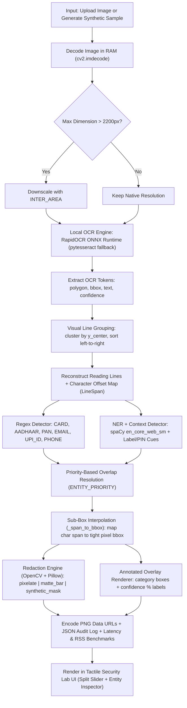
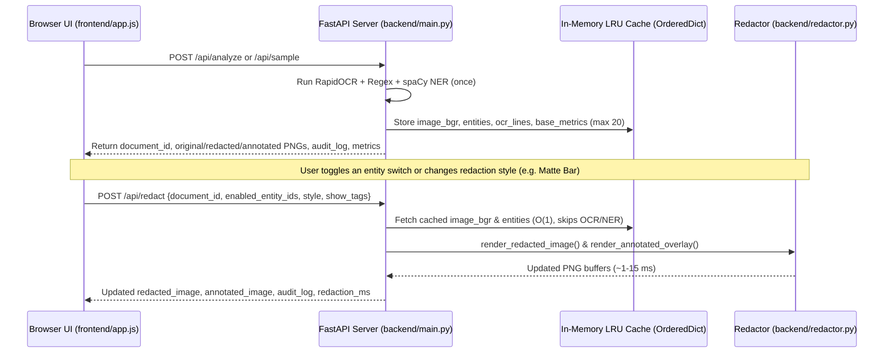

# PrivacyShield — On-Device PII Redaction Lab

**PrivacyShield** is a 100% on-device sensitive information (PII) detection and redaction web application for screenshots, KYC identity documents, and payment receipts. Every stage — OCR, regex pattern matching, named-entity recognition, bounding-box masking, and audit logging — runs **locally on CPU** with **zero bytes sent to the cloud**.

---

## Why PrivacyShield?

Every day, users and support teams share screenshots of Aadhaar cards, PAN cards, UPI payment confirmations, bank cards, and checkout receipts for customer support, expense reimbursement, bug reporting, or social sharing. Manually cropping or scribbling over sensitive fields is slow and error-prone, while uploading unredacted documents to third-party cloud redaction APIs defeats the entire purpose of privacy.

PrivacyShield solves this with four core guarantees:

1. **Zero-Cloud Execution:** All inference (`RapidOCR` via ONNX Runtime, `spaCy`, `OpenCV`, and `Pillow`) executes inside the local FastAPI process. Uploaded images are decoded in RAM and held only in a bounded in-memory LRU cache (`MAX_CACHED_DOCS = 20`) — nothing is written to disk or transmitted externally.
2. **India-First + General PII Coverage:** Combines deterministic regex rules tuned for Indian financial/identity formats (Aadhaar, PAN, UPI VPA handles, `+91` mobile numbers, 16-digit cards) with `spaCy` NER and structural field cues for person names and multi-line addresses.
3. **Surgical Sub-Box Masking:** Instead of blacking out an entire line (including labels like `Aadhaar:` or `PAN:`), character spans are interpolated back onto OCR token widths so only the sensitive value is masked.
4. **Interactive Human-in-the-Loop Control:** A draggable Before/After split-screen slider and per-entity toggle switches let you verify detections visually, inspect confidence scores, and selectively exempt non-sensitive items in milliseconds without re-running OCR.

---

## Sequential Architecture & Flowcharts

### 1. End-to-End Ingestion, Detection & Redaction Pipeline



### 2. Instant Selective Toggle & Style-Switch Sequence



---

## Technical Deep Dive

### 1. Local OCR & Visual Line Reconstruction (`backend/detector.py`)
- **Primary OCR:** `rapidocr-onnxruntime==1.2.3` running on `onnxruntime==1.32.0` (CPU execution provider), returning 4-point polygons, text strings, and confidence scores.
- **Fallback OCR:** `pytesseract` (`image_to_data`) automatically activates if `RapidOCR` is unavailable.
- **Line Grouping (`_group_into_lines`):** OCR engines frequently split spaced fields (such as `4829` `7310` `5942` or multi-word names) into adjacent horizontal boxes. Tokens whose vertical centers fall within `max(10.0, 0.55 * min(h1, h2))` are grouped into a single `ReconstructedLine`, sorted left-to-right, and joined with spaces while preserving exact character index intervals (`LineSpan(item, start, end)`).
- **Sub-Box Coordinate Interpolation (`_span_to_bbox`):** When a PII match occupies `[match_start, match_end)` inside a longer OCR token (e.g. `PAN:ABCDE1234F`), horizontal coordinates are proportionally interpolated across the token's `[x1, x2]` span (`pad_x = 4px`, `pad_y = 3px`), masking only the sensitive substring.

### 2. Hybrid PII Detection & Disambiguation (`backend/detector.py`)

| Entity Type | Priority | Detection Mechanism | Safeguards & Confidence |
| :--- | :---: | :--- | :--- |
| `CARD` | `100` | 16-digit pattern `(?:\d{4}[\s\-]?){3}\d{4}` | Luhn checksum (`_luhn_check`) boosts confidence (`0.98` vs `0.94`) |
| `AADHAAR` | `95` | 12-digit UIDAI format `[2-9]\d{3}[\s\-]?\d{4}[\s\-]?\d{4}` | Excludes `+`-prefixed numbers and ungrouped `91[6-9]...` Indian mobile numbers |
| `PAN` | `92` | Permanent Account Number `[A-Z]{5}[0-9]{4}[A-Z]` | Word-boundary enforced (`0.98` base confidence) |
| `EMAIL` | `90` | RFC-style email regex with TLD check | Evaluated ahead of `UPI_ID` so domains like `@gmail.com` never misclassify as UPI |
| `UPI_ID` | `88` | `[a-zA-Z0-9._\-]{2,64}@([a-zA-Z]{2,20})` | Verified against curated Indian PSP suffixes (`UPI_HANDLES`: `okaxis`, `ybl`, `okicici`, `oksbi`, `paytm`, `ibl`, etc.) |
| `PHONE` | `85` | Indian mobile `(?:\+?91[\s\-]?|0)?[6-9]\d{4}[\s\-]?\d{5}` | Rejects alphanumeric reference codes (`TXN-9048127319`) and transaction/order ID contexts |
| `ADDRESS` | `70` | Label cues (`Address:`, `Billing Address:`) + Indian 6-digit PIN (`[1-9]\d{5}`) + `ADDRESS_KEYWORD_RE` + `spaCy` `GPE`/`LOC`/`FAC` | Supports multi-line continuation when the following line falls within `2.2x` line height |
| `PERSON` | `65` | `spaCy` `en_core_web_sm` `PERSON` entities + label-assisted cues (`Name:`, `Customer:`, `Holder:`, `Paid By:`) | Filters document headings/noise via `NER_STOPWORDS` and `_looks_like_person_name` |

Overlapping candidate spans on the same line are resolved deterministically by `(ENTITY_PRIORITY, span_length, confidence)`. Combined confidence blends pattern/NER confidence (`70%`) with OCR recognition confidence (`30%`).

### 3. Redaction & Overlay Engine (`backend/redactor.py`)
1. **Gaussian Pixelation / Mosaic (`pixelate`):** Downsamples each ROI using `cv2.INTER_AREA` with block size `max(6, min(14, rh // 3))`, upscales via `cv2.INTER_NEAREST` for sharp mosaic blocks, and applies `cv2.GaussianBlur` (`sigmaX=1.4`) to prevent edge reconstruction.
2. **Solid Matte Redaction Bar (`matte_bar`):** Fills the bounding box with `#141413` carbon ink, adds a `#FF4D2D` vermilion left indicator strip, and optionally centers an auto-sized monospace `[ENTITY]` tag.
3. **Smart Synthetic Masking (`synthetic_mask`):** Samples the median RGB color along the ROI's 1px perimeter (`_sample_region_palette`), computes luminance to pick contrasting foreground ink, and renders a format-preserving placeholder (e.g., `XXXX XXXX 0000`, `XXXXX0000X`, `user.redacted@okaxis`, `+91 9XXXX XXXXX`).
4. **Annotated Detection Overlay (`render_annotated_overlay`):** Blends a `0.16` alpha category tint over detected boxes, draws `2px` outlines, and renders `TYPE XX%` badges (grayed with `[OFF]` when toggled off).

### 4. Synthetic Test Fixture Generator (`backend/sample_generator.py`)
Generates high-DPI PNG specimens in memory using Pillow:
- `indian_id` (`1040×680`): Mock citizen KYC sheet containing `PERSON`, `PHONE`, `EMAIL`, `PAN`, `UPI_ID`, multi-line `ADDRESS`, `AADHAAR`, `CARD`, portrait silhouette, and synthetic QR matrix.
- `upi_receipt` (`860×980`): Mock UPI + Card payment receipt containing `PERSON`, `PHONE`, `EMAIL`, payer & merchant `UPI_ID`s, `CARD`, `PAN`, multi-line `ADDRESS`, and a `REF ID: TXN-...` control string.

### 5. FastAPI Server & Benchmarking (`backend/main.py`)
- **Warmup Lifecycle:** `lifespan` pre-loads `RapidOCR` and `en_core_web_sm` on server startup so incoming requests avoid cold-start delays.
- **Real-Time Telemetry:** Uses `time.perf_counter()` to report `ocr_ms`, `nlp_regex_ms`, `redaction_ms`, and total `inference_latency_ms`, plus `psutil.Process(os.getpid()).memory_info().rss` for live `cpu_memory_mb`.
- **Single-Command Serving:** Serves both `/api/*` endpoints and static assets (`frontend/`) from one process, resolving paths relative to `Path(__file__).resolve()` so both `cd backend && uvicorn main:app --reload` and `uvicorn backend.main:app --reload` work identically.

### 6. Tactile Security Lab UI (`frontend/`)
- **Zero-Build Vanilla Stack:** Pure `index.html`, `styles.css`, and `app.js` with `Space Grotesk` + `JetBrains Mono` typography and a Swiss-grid / Braun-inspired palette (`#F4F3EF` stone canvas, `#1C1C1E` hairline borders, `#FF4D2D` safety-vermilion hazard accents, `#10B981` emerald local-verified status).
- **Split-Screen Comparison Slider:** Overlays the redacted output over the raw image using dynamic CSS `clip-path: inset(0 0 0 <pct>%)` driven by pointer capture and keyboard arrow keys.
- **Same-Origin Network Guard (`localApiFetch`):** Verifies `target.origin === window.location.origin` before every request and tracks local IPC bytes vs. `EXTERNAL: 0 B` in the top status monitor.

---

## Project Structure

```text
privacyshield/
├── backend/
│   ├── __init__.py
│   ├── main.py               # FastAPI server (REST API + static frontend)
│   ├── detector.py           # RapidOCR + Regex + spaCy NER + latency/RSS benchmarks
│   ├── redactor.py           # OpenCV/Pillow pixelate, matte bar, synthetic mask + overlay
│   └── sample_generator.py   # Synthetic Indian ID Card & UPI Payment Receipt generator
├── frontend/
│   ├── index.html            # Tactile Security Lab Swiss-grid interface
│   ├── styles.css            # Braun / Teenage Engineering inspired hardware styling
│   └── app.js                # Interactive split-screen slider, entity toggles & audit log
├── requirements.txt          # Pinned CPU-only Python dependencies
└── README.md
```

---

## Setup & Running Locally

### 1. Create a virtual environment and install dependencies
```powershell
python -m venv .venv
.\.venv\Scripts\activate
pip install -r requirements.txt
python -m spacy download en_core_web_sm
```

### 2. Start the server (single command)
From the `backend/` directory:
```powershell
cd backend
uvicorn main:app --reload
```
Or from the repository root:
```powershell
uvicorn backend.main:app --reload
```

### 3. Open in your browser
- **Web App:** [http://127.0.0.1:8000](http://127.0.0.1:8000) (or [http://localhost:8000](http://localhost:8000))
- **Interactive API Docs (Swagger UI):** [http://127.0.0.1:8000/docs](http://127.0.0.1:8000/docs)

---

## API Endpoints

| Method | Path | Description |
| :--- | :--- | :--- |
| `GET` | `/api/health` | Engine readiness (`ocr_engine`, `ner_engine`), CPU RSS memory, and zero-cloud status |
| `POST` | `/api/analyze` | Multipart image upload (`file`, `style`, `show_tags`) -> full detection, redaction & audit log |
| `POST` | `/api/sample` | Generate and analyze a synthetic fixture (`kind`: `indian_id` \| `upi_receipt`) |
| `POST` | `/api/redact` | Re-render redactions instantaneously for toggled `enabled_entity_ids` or style changes |
| `GET` | `/api/sample/{kind}/raw` | Download the unredacted synthetic PNG fixture |
